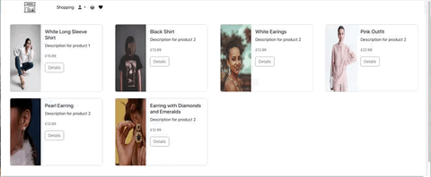
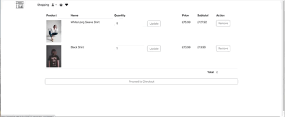
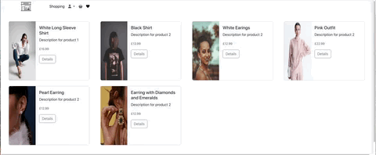
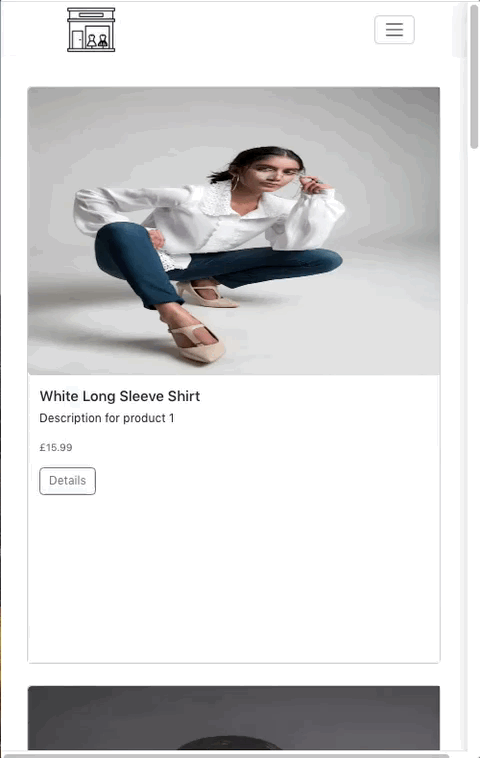

# Shopping New 

This project is a web application built with Flask for the backend and uses SQLite as the database. 
The application provides an online store for products, allowing users to view products, add them to their favorites or basket, and make purchases.

## Project History

First built in 2024 as a Flask shop using Stripe's Charge API. Refactored in 2026: PaymentIntent
checkout, CSRF protection, per-user authorisation, order history, Docker, automated tests and CI.
The full history of both versions is in this repository.

## Deployed Application

View the deployed site [here](https://web-production-fe679.up.railway.app/) (hosted on Railway).

#### Sign up and create new account or try this demo user:
- **Username:** `demo`
- **Password:** `Demo1234!`
## Application Visuals

<p align="center">
  
  
 
</p>
<p align="center">
  
  
</p>
<p align="center">
  
  
</p>


## Responsive Design

<p >
  
  
  
</p>


## 🛠 Technologies Used
**Backend**
- Python 3.11
- Flask 3.0.3 — routing, sessions, Jinja2 templating
- Flask-CORS 4.0.0
- SQLite — lightweight relational database via Python's built-in `sqlite3`
- Werkzeug — `pbkdf2:sha256` password hashing (`generate_password_hash` / `check_password_hash`)
- Stripe 9.4.0 — PaymentIntent API for secure card payments

**Frontend**
- Jinja2 templates
- Bootstrap 5.3.3
- Font Awesome 6.0.0-beta3 — icons
- Public Sans (Google Fonts)
- Custom CSS with CSS variables (red accent `#f56565`, white surface)

**Security**
- CSRF protection on all POST forms — session-bound token validated with `secrets.compare_digest`
- Parameterised SQL queries throughout — no raw string interpolation, prevents SQL injection
- Password hashing with `pbkdf2:sha256:1000000` rounds via Werkzeug
- `@login_required` decorator on all protected routes (basket, favourites, checkout, reviews)
- Per-user authorisation: a user can only read or change their own basket, wishlist and orders (403 otherwise)
- State-changing actions only accept POST, so they are always CSRF-checked
- Orders are recorded idempotently, keyed on the Stripe PaymentIntent id, so a refresh can't create a duplicate order
- Hardened session cookie (`HttpOnly`, `SameSite=Lax`, `Secure` in production); a fresh session is started at login
- Stripe card data never touches the server — handled client-side via Stripe.js


#### Testing, Development and Deployment

- pytest — 16 integration tests (auth, CSRF, cross-user authorisation, SQL injection attempt)
- GitHub Actions — tests run on every push
- Docker — `Dockerfile` with gunicorn, non-root user
- Railway — production hosting


## Features

- **Product catalogue** — 500 products across 15 categories in a CSS Grid layout
- **Product detail** — description, price, payment plan breakdown (full / 4 / 6 instalments), quantity selector
- **Basket** — add items, update quantities, remove items, real-time order summary sidebar
- **Favourites / Wishlist** — save products, move to basket from wishlist
- **Reviews** — logged-in users can leave a title + comment on any product
- **Checkout** — Stripe card element, shipping address form, order confirmation page
- **Auth** — register (with password validation), login, logout with Flask session management
- **CSRF protection** — every POST form carries a cryptographically random session-bound token
- **Responsive** — mobile-friendly at all screen sizes via Bootstrap 5 grid

---


## Database Schema

Seven tables in `productdb.db`:

```sql
Users        — user_id, username, password (hashed), email
products     — id, name, description, price, image_url
Basket       — basket_id, user_id, product_id, quantity
Favorites    — user_id, product_id  (composite primary key)
review       — review_id, user_id, product_id, name, description
Orders       — order_id, user_id, order_date, total, status
OrderDetails — order_details_id, order_id, product_id, quantity, price_at_time_of_order
```

Connections use `sqlite3.Row` factory so rows can be accessed by column name or index.

---

## Running Locally


### 1. Create and activate a virtual environment

```bash
python3 -m venv venv
source venv/bin/activate        # Mac / Linux
venv\Scripts\activate           # Windows
```

### 2. Install dependencies

```bash
pip install -r requirements.txt
```

### 3. Set environment variables

```bash
export SECRET_KEY="your-long-random-secret"
export STRIPE_SECRET_KEY="sk_test_..."
export STRIPE_PUBLIC_KEY="pk_test_..."
```

> Get your Stripe test keys from [dashboard.stripe.com/test/apikeys](https://dashboard.stripe.com/test/apikeys)
>
> Generate a secure `SECRET_KEY`:
> ```bash
> python3 -c "import secrets; print(secrets.token_hex(32))"
> ```

### 4. Database is ready to go

`productdb.db` is included — 500 products and the demo user are already seeded.


```bash
python seed-db.py
```

### 5. Run the development server

```bash
python app.py
```

Open [http://127.0.0.1:5000](http://127.0.0.1:5000)

### Run with Docker

```bash
docker build -t shopping-app .
docker run -p 8000:8000 \
  -e SECRET_KEY="your-long-random-secret" \
  -e STRIPE_SECRET_KEY="sk_test_..." \
  -e STRIPE_PUBLIC_KEY="pk_test_..." \
  shopping-app
```

Open [http://127.0.0.1:8000](http://127.0.0.1:8000)

### Run the tests

```bash
pip install -r requirements-dev.txt
pytest -q
```

Tests run against a temporary copy of the database, so `productdb.db` is never modified.

---


---

## Key Code Decisions

### CSRF protection without a library

A random token is generated per session and injected into all templates automatically via Flask's context processor:

```python
@app.context_processor
def inject_csrf():
    return dict(csrf_token=generate_csrf(), stripe_public_key=STRIPE_PUBLIC_KEY)
```

Every POST form includes:
```html
<input type="hidden" name="csrf_token" value="{{ csrf_token }}" />
```

On every POST route, the submitted token is compared with `secrets.compare_digest` (timing-safe) before any action is taken.

### Parameterised queries — SQL injection prevention

All database queries use `?` placeholders, never string formatting:

```python
cur.execute(
    'SELECT * FROM users WHERE username = ?',
    (username,)
)
```

### Password hashing with Werkzeug

```python
from werkzeug.security import generate_password_hash, check_password_hash

# On register
hashed = generate_password_hash(password)  # pbkdf2:sha256:1000000$...

# On login
if check_password_hash(stored_hash, submitted_password):
    # grant access
```

### Jinja2 namespace for running totals

Jinja2 3.x does not support `__setattr__` — namespace variables must use dot-assignment syntax:

```jinja2


  

Total: £{{ "%.2f"|format(total.value) }}
```

---

## Wins & Challenges

**Wins**
- Full CSRF protection implemented manually without Flask-WTF — deeper understanding of the attack and defence
- Stripe PaymentIntent API gives a PCI-compliant checkout: card data never touches the server
- CSS Grid with `auto-fill, minmax(340px, 1fr)` makes the product catalogue fully responsive with no JavaScript

**Challenges**
- **Jinja2 namespace syntax** — `` is required in Jinja2 3.x; the older `__setattr__` approach raises `UndefinedError`
- **CSRF across all forms** — needed careful auditing to ensure every POST form (basket, favourites, reviews, checkout, login, register) includes the token

**Future Improvements**
- User profile page with order history
- Product search and category filtering
- Admin dashboard for managing products and orders
- PostgreSQL for production-scale deployments
- Email confirmation on registration and order placement

---

*Built by [Maryam Hazrati](https://maryam-hazratiii.netlify.app) · Secure payments powered by Stripe*